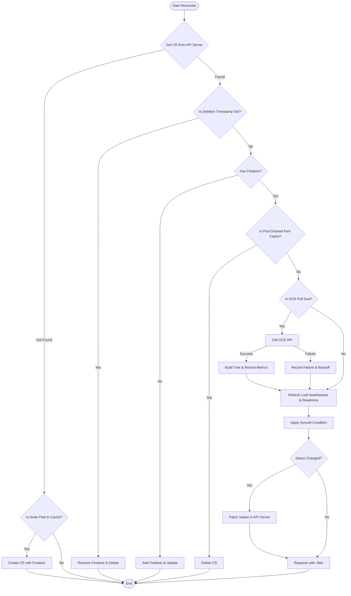

# PartitionTree

A Kubernetes controller that reflects GCE Managed Instance Group (MIG) accelerator topology into cluster-scoped `PartitionTree` custom resources. It gives schedulers and autoscalers a live, in-cluster view of TPU partition hierarchy, health state, and occupancy without querying GCE directly.

## How it works

```
GCE MIG API                          Kubernetes
+---------------------------+        +----------------------------+
| GetAvailableAccelerator   |  poll  | PartitionTree CR           |
| Topologies(project,zone,  | -----> |   .status.partitionId      |
|            mig)           |        |   .status.state: Healthy   |
+---------------------------+        |   .status.childPartitions: |
                                     |     - partitionId: leaf-0  |
Node informer                        |       nodeNames: [node-1]  |
+---------------------------+        |       conditions:          |
| watch Nodes with label    | -----> |         - type: NodeReady  |
| gke-accelerator-topology- |        +----------------------------+
|   mode=PROVISION_ONLY     |
+---------------------------+
```

1. The controller watches Nodes labeled `cloud.google.com/gke-accelerator-topology-mode: PROVISION_ONLY`.
2. When a matching node appears, the controller looks up the node's MIG via the `node.gke.io/created-by-mig` annotation and creates a `PartitionTree` CR named after the node pool (or after the root partition ID in [decoupled mode](#decoupled-lifecycle)).
3. Every polling interval (default 1s), the controller calls the GCE `GetAvailableAcceleratorTopologies` API, builds the partition tree, and patches `.status`.
4. Leaf partitions carry `nodeNames` (from the node cache) and a `NodeReady` condition. By default it reflects kubelet `Ready`; with `--enable-tpu-allocatable-readiness` it also requires every node's TPU chips to be allocatable (see [TPU Allocatable Readiness](#tpu-allocatable-readiness)).
5. A top-level `Synced` condition tracks whether the tree is current with GCE.

## Provisioning TPU Node Pools

PartitionTree consumes TPU node pools provisioned for Dynamic Slicing. For the full workflow — placement policies, reservation targeting, and supported machine types — see [GKE Dynamic Slicing](https://docs.cloud.google.com/kubernetes-engine/docs/concepts/dynamic-slicing).

*Note: For now, PartitionTree supports TPU `v6e` and `v7x`.*

## GCE authentication

The controller calls `InstanceGroupManagers.GetAvailableAcceleratorTopologies` on the compute/v0.beta API and, by default (`--enable-google-internal-metrics=true`), exports `PartitionTree` metrics directly to Cloud Monitoring (`monitoring.googleapis.com`). It uses Google's **Application Default Credentials (ADC)**, which means it does not embed any secrets — the runtime environment must provide credentials with both `roles/compute.viewer` and `roles/monitoring.metricWriter`.

### GKE with Workload Identity (recommended)

Workload Identity is the recommended way to grant permissions. It requires setting up the cluster infrastructure first, and then configuring the application.


#### Step 1: Enable Workload Identity on the Cluster and Node Pool

You must enable Workload Identity on your cluster and the specific node pool running the controller. Pick the option that matches your situation.

**Option A: Enable during cluster creation (recommended for new clusters)**

```bash
gcloud container clusters create CLUSTER_NAME \
  --region=REGION \
  --workload-pool=YOUR_PROJECT.svc.id.goog \
  # ... other cluster creation flags
```

Newly created node pools on a Workload-Identity-enabled cluster inherit `--workload-metadata=GKE_METADATA` automatically, so no additional node-pool step is required when you create the CPU node pool later.

**Option B: Enable on an existing cluster**

If your cluster is already running, update the cluster and then enable the metadata server on the CPU node pool that will host the controller:

```bash
# 1. Enable Workload Identity on the existing cluster
gcloud container clusters update CLUSTER_NAME \
  --region=REGION \
  --workload-pool=YOUR_PROJECT.svc.id.goog

# 2. Enable GKE Metadata Server on the CPU node pool
gcloud container node-pools update CPU_NODE_POOL_NAME \
  --cluster=CLUSTER_NAME \
  --region=REGION \
  --workload-metadata=GKE_METADATA
```

#### Step 2: Configure the Application Identities

1. Create a GCP service account and grant the required IAM roles:

   ```bash
   gcloud iam service-accounts create partition-controller \
     --project=YOUR_PROJECT

   # Read MIG accelerator topology from GCE
   gcloud projects add-iam-policy-binding YOUR_PROJECT \
     --member="serviceAccount:partition-controller@YOUR_PROJECT.iam.gserviceaccount.com" \
     --role="roles/compute.viewer"

   # Export PartitionTree metrics to Cloud Monitoring (required by default
   # when --enable-google-internal-metrics=true or --metrics-direct-push=true)
   gcloud projects add-iam-policy-binding YOUR_PROJECT \
     --member="serviceAccount:partition-controller@YOUR_PROJECT.iam.gserviceaccount.com" \
     --role="roles/monitoring.metricWriter"
   ```

2. Bind the GCP service account to the Kubernetes service account:

   ```bash
   gcloud iam service-accounts add-iam-policy-binding \
     partition-controller@YOUR_PROJECT.iam.gserviceaccount.com \
     --role="roles/iam.workloadIdentityUser" \
     --member="serviceAccount:YOUR_PROJECT.svc.id.goog[partition-system/partition-controller-manager]"
       ```
    *(Note: The format `[partition-system/partition-controller-manager]` represents `[namespace/kubernetes-service-account-name]`. This name is constructed by taking the base name `controller-manager` from `config/rbac/service_account.yaml` and prepending the `namePrefix` from `config/default/kustomization.yaml`)*.

3. Annotate the Kubernetes service account (add to `config/rbac/service_account.yaml` or patch after deploy):

   ```bash
   kubectl annotate serviceaccount partition-controller-manager \
     -n partition-system \
     iam.gke.io/gcp-service-account=partition-controller@YOUR_PROJECT.iam.gserviceaccount.com
   ```

### GKE node service account (alternative)

If you choose not to use Workload Identity, the alternative is to grant permissions directly to the GKE node pool where the controller runs.

To do this:
1.  **Ensure the node's service account has the required IAM roles.** The controller pod will inherit the permissions of the service account attached to the node.

    ```bash
    gcloud projects add-iam-policy-binding YOUR_PROJECT \
      --member="serviceAccount:YOUR_NODE_SERVICE_ACCOUNT" \
      --role="roles/compute.viewer"

    gcloud projects add-iam-policy-binding YOUR_PROJECT \
      --member="serviceAccount:YOUR_NODE_SERVICE_ACCOUNT" \
      --role="roles/monitoring.metricWriter"
    ```
    *(Note: Replace `YOUR_NODE_SERVICE_ACCOUNT` with the email of the service account used by your node pool. You can find it by running:

    ```bash
    gcloud container node-pools describe CPU_NODE_POOL_NAME \
      --cluster=CLUSTER_NAME \
      --region=REGION \
      --format="value(config.serviceAccount)"
    ```

    If it returns `default`, it refers to the Compute Engine default service account: `PROJECT_NUMBER-compute@developer.gserviceaccount.com`.

    > [!NOTE]
    > If you use the default Compute Engine service account, this step might seem optional in older projects because GCP automatically granted it the broad `Editor` role. However, for projects created after **May 3, 2024**, this automatic grant is disabled by default. Use a custom, least-privileged service account for your node pools and explicitly grant both `roles/compute.viewer` and `roles/monitoring.metricWriter` as shown above.)*

2.  **Create the CPU node pool** for the controller and add the required scope. The controller deployment uses a `nodeSelector` targeting `cpu-pool`, so you must label the nodes accordingly.

    ```bash
    gcloud container node-pools create cpu-pool \
      --cluster=CLUSTER_NAME \
      --region=REGION \
      --node-labels=cloud.google.com/gke-nodepool=cpu-pool \
      --scopes=https://www.googleapis.com/auth/cloud-platform
    ```

### Local development

For running the controller outside a cluster, ADC falls through to your local gcloud credentials. Authenticate once, install the CRDs, then choose the `go run` invocation that fits what you're doing.

```bash
# 1. Authenticate (one-time)
gcloud auth application-default login

# 2. Install CRDs into your current kube context
make install

# 3a. Default: run against real GCE
go run ./cmd --config-namespace=default

# 3b. Or, shorthand wrapper that does the same thing
make run

# 3c. Run with decoupled lifecycle mode
go run ./cmd --config-namespace=default --decoupled-lifecycle

# 3d. Run with OpenTelemetry metrics enabled (e.g. GKE Managed OTel)
# NOTE: --otlp-endpoint defaults to empty (OTel disabled). You must
# set it explicitly to enable metrics export.
go run ./cmd \
  --config-namespace=default \
  --otlp-endpoint=opentelemetry-collector.gke-managed-otel.svc.cluster.local:4317

# 3e. Run with direct push to Google Cloud Monitoring (no collector required)
go run ./cmd \
  --config-namespace=default \
  --metrics-direct-push
```


## Prerequisites

- Go 1.25+
- Docker (for building the manager image)
- kubectl configured against your target cluster
- A GKE cluster with TPU node pools (for production), or Kind (for testing)

> **⚠️ GCE API allowlisting & IAM required:** The controller calls the `GetAvailableAcceleratorTopologies` beta API, which requires your project to be **allowlisted** before use and `roles/compute.viewer` on the controller's GCP service account; otherwise polling fails with `googleapi: Error 403`. In addition, default Cloud Monitoring metric export (`--enable-google-internal-metrics=true` or `--metrics-direct-push=true`) requires **`roles/monitoring.metricWriter`** (`monitoring.timeSeries.create`); without it, `CreateTimeSeries` calls fail with `PermissionDenied` (`403`) even when topology reconciliation succeeds.


## Quick start

### Install into a cluster

```bash
# Build and push the manager image
export IMG=us-central1-docker.pkg.dev/YOUR_PROJECT/partitiontree/partitiontree:latest
make docker-build docker-push IMG=$IMG

# Deploy CRD, RBAC, controller, and default config
make deploy IMG=$IMG
```

This applies the full Kustomize bundle from `config/default/`, which creates:
- The **`partition-system`** namespace (Created automatically. This is the isolated environment for the controller).
- The `PartitionTree` CRD (cluster-scoped).
- RBAC (ClusterRole, ServiceAccount, bindings).
- The **`partition-controller-manager`** Deployment (The actual controller software, configured to run on a CPU node pool to save costs).
- A seeded `partition-config` ConfigMap with default tuning.
- A metrics Service on port 8443 (HTTPS).

### One-file install (alternative)

```bash
make build-installer IMG=$IMG
kubectl apply -f dist/install.yaml
```

### Helm chart install

A Helm chart is provided for production deployments.

#### Step 1: Install CRDs

CRDs are managed outside the Helm chart (so `helm uninstall` never accidentally deletes your PartitionTree CRs).

```bash
kubectl apply -f config/crd/bases
```

#### Step 2: Install the chart

```bash
export IMG=us-central1-docker.pkg.dev/YOUR_PROJECT/partitiontree/partitiontree:latest
make docker-build docker-push IMG=$IMG

helm upgrade --install partition-tree ./charts/partition-tree \
    --namespace partition-system \
    --create-namespace \
    --set image.repository=us-central1-docker.pkg.dev/YOUR_PROJECT/partitiontree/partitiontree \
    --set image.tag=latest
```

#### Enable feature flags

```bash
# Enable all taint features:
helm upgrade --install partition-tree ./charts/partition-tree \
    --namespace partition-system \
    --create-namespace \
    --set image.repository=us-central1-docker.pkg.dev/YOUR_PROJECT/partitiontree/partitiontree \
    --set image.tag=latest \
    --set enableTaints=true \
    --set decoupledLifecycle=true

# Or enable specific taint features (e.g. via --set or values.yaml):
# --set enableTaints="NodeTaints\,NodesNotFound"
# Or in values.yaml:
# enableTaints:
#   - NodeTaints
#   - NodesNotFound

# Also require every node's TPU chips to be allocatable for NodeReady=True:
# --set tpuAllocatableReadiness=true
```

#### Enabling Debug Logs

The controller uses `controller-runtime`'s `zap` logger. Enable debug logs via Helm values:

*   **Basic Debug Logs (V(1)):**

    ```bash
    --set debug.enabled=true --set debug.level=1
    ```

*   **Detailed Debug Logs (V(2) and higher):**

    ```bash
    --set debug.enabled=true --set debug.level=2
    ```

#### Configurable Values

| Value | Default | Description |
|---|---|---|
| `image.repository` | `partition-tree-controller` | Controller image name |
| `image.tag` | `latest` | Image tag |
| `replicaCount` | `1` | Number of replicas |
| `resources.limits.memory` | `512Mi` | Memory limit |
| `resources.requests.memory` | `256Mi` | Memory request |
| `nodeSelector` | `cpu-pool` | Node selector for scheduling |
| `config.create` | `true` | Create runtime ConfigMap |
| `config.name` | `partition-config` | ConfigMap name |
| `otlp.endpoint` | GKE Managed OTel | OpenTelemetry endpoint |
| `gce.endpoint` | `""` | Override GCE API endpoint |
| `gce.useStaging` | `false` | Use staging API endpoint |
| `serviceAccount.annotations` | `{}` | ServiceAccount annotations (e.g. `iam.gke.io/gcp-service-account` for Workload Identity; GCP SA requires `roles/compute.viewer` and `roles/monitoring.metricWriter`) |
| `metrics.enabled` | `true` | Enable metrics endpoint |
| `metrics.port` | `8443` | Metrics port |
| `metrics.secure` | `true` | HTTPS metrics |
| `metrics.enableGoogleInternalMetrics` | `true` | Push `kubernetes.io/internal/addons/partition_tree/*` metrics directly to Cloud Monitoring (requires `roles/monitoring.metricWriter`) |
| `metrics.directPush` | `false` | Push customer `prometheus_target` metrics directly to Cloud Monitoring without a collector (requires `roles/monitoring.metricWriter`) |
| `debug.enabled` | `false` | Enable debug logging |
| `debug.level` | `1` | Zap log verbosity level |
| `enableTaints` | `false` | Enable taint propagation (`true`, `false`, array like `[NodeTaints, NodesNotFound]`, or comma-separated string) |
| `decoupledLifecycle` | `false` | Enable decoupled CR lifecycle |
| `tpuAllocatableReadiness` | `false` | Require every node in a leaf to have its full `google.com/tpu` chip count allocatable for `NodeReady=True` (Reason `TPUsNotAllocatable`). See [TPU Allocatable Readiness](#tpu-allocatable-readiness) |
| `enableHTTP2` | `false` | Enable HTTP/2 |

#### Helm uninstall

```bash
# Removes the controller (CRDs are preserved)
helm uninstall partition-tree --namespace partition-system
```

> **Note:** CRDs are installed separately and are **not** removed by `helm uninstall`. This is intentional — removing the CRD would delete all existing PartitionTree CRs. To fully remove CRDs: `kubectl delete -f config/crd/bases`.

#### Workload Identity annotation

If you are using Workload Identity (see [GCE authentication](#gce-authentication)), pass the SA annotation at install time:

```bash
helm upgrade --install partition-tree ./charts/partition-tree \
    --namespace partition-system \
    --create-namespace \
    --set image.repository=YOUR_IMAGE \
    --set image.tag=YOUR_TAG \
    --set serviceAccount.annotations."iam\.gke\.io/gcp-service-account"=partition-controller@YOUR_PROJECT.iam.gserviceaccount.com
```


### Verify

```bash
# 1. Verify the CRD is installed
kubectl get crds | grep partition
# Expected output: partitiontrees.partition.tpu.google.com            <date>

# 2. Controller pod should be Running
kubectl -n partition-system get pods

# 3. Check controller logs (useful if something goes wrong)
kubectl -n partition-system logs deployment/partition-controller-manager

# 4. On a GKE cluster with TPU node pools, CRs appear automatically
kubectl get partitiontrees

# 5. Inspect a tree
kubectl get partitiontree my-tpu-pool -o yaml
```

### Uninstall

```bash
# Removes all resources created by 'make deploy'
make undeploy
```

### Troubleshooting & Gotchas

#### Image Pull Issues
If the pod fails to start with `ImagePullBackOff`:
1. Ensure the `IMG` variable points to a repository your cluster can access.
2. Ensure your cluster's Node Service Account has read access to the Artifact Registry. You can grant this by giving the service account the **Storage Object Viewer** role on the project or repository.
   * To find your node service account: `gcloud iam service-accounts list --project=YOUR_PROJECT` (look for the account used by the GKE nodes).

#### Role of Node Selector
In `config/manager/manager.yaml`, the deployment uses a `nodeSelector` targeting `cpu-pool`.
* **What it does:** It ensures that the controller pod is scheduled *only* on nodes belonging to the CPU pool (nodes with the label `cloud.google.com/gke-nodepool: cpu-pool`).
* **Why it's needed:** The controller only manages metadata and calls APIs; it does not need expensive TPU hardware. By using a node selector, we prevent the controller from taking up space on TPU nodes that are reserved for actual AI workloads, and ensure it runs on a cheaper CPU pool.

#### Understanding Controller Logs
To view the logs of the controller:
```bash
kubectl -n partition-system logs deployment/partition-controller-manager
```

**What they mean:**
*   **`Attempting to acquire leader lease...`**: The controller is waiting to become the active leader. If it hangs here, an old lease might need manual deletion.
*   **`GCE poll failed`**: The controller failed to fetch topology from GCE. Check the error details (e.g., 403 Forbidden usually indicates missing permissions or Workload Identity issues).
*   **`PartitionTreeCreated`**: Confirms a new tree has been successfully created for a node pool.

## Configuration

The controller reads runtime config from the `partition-config` ConfigMap in its namespace. Edits are hot-reloaded without a restart.

```yaml
apiVersion: v1
kind: ConfigMap
metadata:
  name: partition-config
  namespace: partition-system
data:
  config.yaml: |
    polling:
      interval: 1s       # GCE poll cadence
      jitter: 100ms       # +/- random spread to avoid thundering herd
    syncTimeout: 15s      # grace period before Synced flips to False
    retry:
      initialBackoff: 1s  # first retry delay after GCE error
      maxBackoff: 30s     # backoff cap
      multiplier: 2.0     # exponential factor
    rateLimit:
      qps: 50             # sustained GCE API requests per second
      burst: 50           # max burst above QPS
    concurrency:
      maxReconciles: 8    # parallel reconcile workers
    taints:
      nodePropagation:
        excludedPrefixes: ["google.com/tpu"] # prefixes of node taints to ignore
```

If the ConfigMap is absent, the controller uses built-in defaults (same values as above). Invalid updates are rejected and the previous good config stays in effect.

**Hot-reload vs. startup-only settings:** The `polling`, `syncTimeout`, and `retry` sections are hot-reloaded immediately. The `rateLimit` and `concurrency` sections are read once at startup — a controller restart is required for changes to take effect. This is by design: changing rate limits or worker counts at runtime risks quota exhaustion or resource contention.

### Feature Flags

The controller supports enabling experimental or optional features via command-line flags.

* `--enable-taints` (default: `false`): Enables the Taints feature. Accepts comma-separated values (`All`, `NodeTaints`, `NodesNotFound`, `PartitionState`) or boolean (`true` = `All`, `false` = disabled). See the [Taints](#taints) section below for details.
* `--decoupled-lifecycle` (default: `false`): Enables decoupled CR lifecycle. See the [Decoupled Lifecycle](#decoupled-lifecycle) section below for details.
* `--enable-tpu-allocatable-readiness` (default: `false`): Makes a leaf's `NodeReady` condition also require every node to have its full TPU chip count allocatable (`google.com/tpu`), with the new Reason `TPUsNotAllocatable`. Read at startup only. See the [TPU Allocatable Readiness](#tpu-allocatable-readiness) section below for details.

## Taints

PartitionTree supports surfacing taints directly within the hierarchical status tree. This allows schedulers to make aware placement decisions by observing taints on specific partitions without needing to poll individual Kubernetes nodes.

To enable taint features, the controller can be started with the `--enable-taints` flag using comma-separated option values:
* Unset values: `All` (passing `--enable-taints` or `--enable-taints=true` enables all taint features)
* Value options:
  * `NodeTaints`: Propagates Node taints to PartitionTree taints (includes Node unready / unreachable)
  * `NodesNotFound`: Propagates NodesNotFound PartitionTree conditions to partition taints
  * `PartitionState`: Propagates non-healthy partition states to partition taints
* Example: `--enable-taints=NodeTaints,NodesNotFound`

When `--enable-taints` is set, custom taint annotations on `PartitionTree` (`taints.partitiontree.gke.io/`) are always propagated to the partition `taints` field.

### State to Taint Mapping

When the `--enable-taints` flag includes `PartitionState` (`--enable-taints=PartitionState` or `--enable-taints=All`), non-healthy partition states are propagated as taints on that partition:
* Key: `cloud.google.com/partition-state`
* Value: The string representation of the state (`Unhealthy`, `Degraded`, `Incomplete`, `Unknown`)
* State to taint effect:
  * `Unhealthy` → `NoExecute`
  * `Degraded` → `PreferNoSchedule`
  * `Incomplete` → `NoSchedule`
  * `Unknown` → `NoSchedule`

### Condition to Taint Mapping

When the `--enable-taints` flag includes `NodesNotFound` (`--enable-taints=NodesNotFound` or `--enable-taints=All`), the controller maps the `NodeReady: False` condition with reason `NodesNotFound` to a taint on that leaf partition:
* Key: `cloud.google.com/nodes-not-found`
* Effect: `NoExecute`

This covers situations where nodes are absent from the cache for a given topology, which is solely calculated by the PartitionTree controller.

### Node Taint Propagation

When `--enable-taints` includes `NodeTaints` (`--enable-taints=NodeTaints` or `--enable-taints=All`), the controller automatically propagates taints from Kubernetes `Node` objects to their corresponding leaf partitions in the `PartitionTree`.

This follows an opt-out model: all node taints will propagate by default, except for those matching the configured excluded prefixes. This means any new taint added to a node will automatically propagate unless explicitly excluded.

1.  **Configuration:** Configure the excluded taint prefixes in the `partition-config` ConfigMap. It defaults to excluding `google.com/tpu` taints:
    ```yaml
    taints:
      nodePropagation:
        excludedPrefixes:
        - "google.com/tpu"
    ```

### External Taints (via Annotations)

When `--enable-taints` is set, you can apply taints by adding annotations to your `PartitionTree` custom resource.
Each taint must be defined as a separate annotation with the prefix `taints.partitiontree.gke.io/`. The suffix of the annotation key can be any unique name to identify the taint (e.g., `taints.partitiontree.gke.io/maintenance`). This allows multiple systems to manage taints independently without overwriting each other's configuration.

The value of each annotation must be a JSON object containing the `partitionId` of the partition you want to taint, along with the `key`, `value` (optional), and `effect`.

> [!NOTE]
> The annotation suffix (the part after the slash) does not need to match the taint `key` defined inside the JSON. The suffix is only used to uniquely identify the annotation itself. For example, you can use `taints.partitiontree.gke.io/recommender-lock` to apply a taint with the key `example.com/degraded`.

**Example command to apply a taint:**

```bash
kubectl annotate partitiontree my-tpu-pool \
  taints.partitiontree.gke.io/maintenance='{"partitionId":"leaf-0","key":"example.com/maintenance","value":"ongoing","effect":"NoSchedule"}' \
  --overwrite
```

### Taint Application in Status

The controller parses these targeted taints and applies them directly to the specified partitions within the `PartitionTree` status. Taints are only present on the partitions where they are explicitly targeted; they do not propagate or "bubble up" the tree.

If the `--enable-taints` flag is set to `false`, the controller ignores these annotations and clears any existing `taints` (both external and propagated node taints) from the status tree.

## Decoupled Lifecycle

The `--decoupled-lifecycle` flag changes how PartitionTree CRs are named and managed, enabling CRs to survive node pool deletion and recreation.

### Default mode (flag OFF)

| Aspect | Behavior |
|--------|----------|
| CR name | Node pool name (e.g. `my-tpu-pool`) |
| On node pool delete | CR is deleted (`NodePoolDrained` event) |
| On node pool recreate | New CR created from scratch |

### Decoupled mode (flag ON)

| Aspect | Behavior |
|--------|----------|
| CR name | Sanitized root partition ID from GCE topology (e.g. `fba785f80d18552357dcdef6d3d16c27`) |
| On node pool delete | CR is preserved with `Synced=False, Reason=PoolDrained`, MIG annotation cleared, tree cleared |
| On node pool recreate | Same CR recovers: new MIG annotation set, tree rebuilt, `Synced=True` |
| GCE polling when drained | Suspended (no API calls for idle CRs) |

### Enabling decoupled mode

Add the flag to the controller deployment:

```yaml
# In config/manager/manager.yaml or your kustomize overlay:
containers:
- name: manager
  args:
  - --decoupled-lifecycle
  # ... other flags
```

Or for local development:

```bash
go run ./cmd --config-namespace=default --decoupled-lifecycle
```

### Key behaviors

- **CR creation on startup**: If the controller starts in decoupled mode and matching nodes already exist, it creates CRs immediately (the node informer pushes a create update to the reconciler).
- **Drain detection**: When all nodes leave a pool, the node informer detects the drain via the topology cache and pushes a drain update. The reconciler clears the MIG annotation and sets `Synced=False, Reason=PoolDrained`.
- **Re-provision detection**: When a new node pool is created with nodes in the same physical partition, the node informer detects the new MIG and pushes an update. The reconciler sets the new MIG annotation and resumes GCE polling.
- **Events**: In decoupled mode, drain emits `NodePoolDrained` with a message indicating the MIG annotation was cleared (instead of deleting the CR). Re-provision emits `NodePoolReprovisioned` and `SyncRestored` events.

## TPU Allocatable Readiness

By default a leaf's `NodeReady` condition mirrors kubelet `Ready`. A node can be kubelet-Ready while its TPU chips are unusable, for example:

- After a reboot or on a new node, before the TPU device plugin registers its chips.
- After a TPU device plugin or kubelet restart, until the plugin re-registers.
- While the device plugin's `ListAndWatch` stream is dead, or while a chip is unhealthy.

In these states `status.allocatable["google.com/tpu"]` is below the host's chip count (or absent), but `NodeReady` would still read `True`, so placement that gates on `NodeReady` can pick a host without usable chips.

The `--enable-tpu-allocatable-readiness` flag (Helm value `tpuAllocatableReadiness`) closes this gap. With the flag set, a leaf's `NodeReady` is `True` only if every expected node is found, kubelet-Ready, **and** reports its full chip count allocatable: 4 chips per host for `tpu7x` and `tpu-v6e-slice`. An absent `google.com/tpu` entry counts as 0.

| Reason | Status | When |
|--------|--------|------|
| `NodesNotFound` | `False` | An expected node is missing from the node cache (or no nodes are assigned) |
| `NodesNotReady` | `False` | All nodes are found, but at least one is not kubelet-Ready |
| `TPUsNotAllocatable` | `False` | All nodes are found and kubelet-Ready, but at least one reports fewer chips allocatable than its accelerator provides (flag only) |
| `NodesReady` | `True` | All nodes are found, kubelet-Ready and, with the flag, report their full chip count |

The reasons are evaluated in that order (`NodesNotFound` > `NodesNotReady` > `TPUsNotAllocatable` > `NodesReady`). The message lists the affected nodes as `allocatable/expected`:

```yaml
conditions:
  - type: NodeReady
    status: "False"
    reason: TPUsNotAllocatable
    message: "nodes with TPU chips not allocatable: [gke-my-tpu-pool-0-xxxx (0/4)]"
```

### Key behaviors

- **Flag off**: behavior is unchanged. The node cache drops `status.allocatable` and `NodeReady` is derived from kubelet `Ready` only.
- **Node cache**: with the flag on, the cache keeps only the `google.com/tpu` entry of `status.allocatable`, and a change in that value triggers a reconcile, so `NodeReady` returns to `True` as soon as the device plugin registers the chips.
- **Continuous outage window**: `Status` stays `False` when a rebooting node moves from `NodesNotReady` to `TPUsNotAllocatable`, so `lastTransitionTime` spans the whole window.
- **Reading the condition**: `NodeReady` no longer mirrors `kubectl get node`. A leaf can be `False` while every node shows `Ready`; check the Reason and message.
- **Taints**: `TPUsNotAllocatable` does not produce a partition taint. The `NodesNotFound` taint option still maps only Reason `NodesNotFound`.
- **Consumers**: anything that gates on the leaf's `NodeReady` condition keeps nodes without allocatable chips out of placement without code changes, for example slice-scheduler with `--enable-node-readiness` in versions that read leaf readiness from the PartitionTree. Consumers that read kubelet `Ready` from the Node object directly are not affected.
- **Startup only**: the flag is read at startup; restart the controller to change it.

### Enabling TPU allocatable readiness

```yaml
# In config/manager/manager.yaml or your kustomize overlay:
containers:
- name: manager
  args:
  - --enable-tpu-allocatable-readiness
  # ... other flags
```

Or with Helm: `--set tpuAllocatableReadiness=true`.

## CRD reference

```yaml
apiVersion: partition.tpu.google.com/v1beta1
kind: PartitionTree        # cluster-scoped, one per GKE node pool
metadata:
  name: my-tpu-pool        # matches the node pool name (or partition ID in decoupled mode)
  annotations:
    tpu.gke.io/mig-name: projects/123/zones/us-central1-a/instanceGroupManagers/my-mig
  finalizers:
    - partition.tpu.google.com/finalizer
status:
  acceleratorType: v7x
  conditions:               # top-level conditions for the whole CR
    - type: Synced
      status: "True"
      reason: InSync
      message: last successful poll at 2026-04-11T12:00:00Z
  root:                     # the partition tree lives under .status.root
    partitionId: root
    topology: 4x4x4
    state: Healthy          # Healthy | Unhealthy | Degraded | Incomplete | Unknown
    occupancy: Empty        # Empty | Occupied | Unspecified
    childPartitions:
      - partitionId: leaf-0
        topology: 2x2x1
        state: Healthy
        occupancy: Empty
        sliceId: "some-slice-id"
        nodeNames:
          - gke-my-tpu-pool-0-xxxx
        conditions:
          - type: NodeReady
            status: "True"
            reason: NodesReady
            message: all expected nodes are Ready
```

**Key fields:**
- `.status.root.state` reflects GCE's `AcceleratorTopologyHealth` per partition.
- `.status.root.occupancy` is `Occupied` if any leaf has a `SliceID` or the root has `MultiMig`; bubbles up to ancestors.
- `NodeReady` condition is set only on leaves (under `.status.root...conditions`); it is never bubbled. Reasons: `NodesReady`, `NodesNotReady`, `NodesNotFound`, and `TPUsNotAllocatable` (only with `--enable-tpu-allocatable-readiness`; see [TPU Allocatable Readiness](#tpu-allocatable-readiness)).
- `Synced` condition lives at `.status.conditions` (top-level, not per-partition) and tracks GCE poll freshness.
- In decoupled mode, `Synced=False, Reason=PoolDrained` indicates the CR is idle (node pool deleted) and GCE polling is suspended.


**The controller manages the full lifecycle.** Do not create, edit, or delete PartitionTree CRs by hand. The controller creates a CR when it first sees a matching node, updates `.status` on every poll, and deletes the CR when the node pool drains (default mode) or preserves it in a drained state (decoupled mode).

**Events:** The controller emits Kubernetes events via the `events.k8s.io/v1` API (not legacy `v1.Event`). Key events: `PartitionTreeCreated`, `SyncRestored`, `SyncLost`, `GCEPollFailed`, `NodePoolDrained`. Query events with:

```bash
kubectl get events.v1.events.k8s.io --field-selector=reason=PartitionTreeCreated
```

## Visualization (ptree-viz)

A CLI tool for inspecting PartitionTree CRs as ASCII trees or fleet summary tables. Useful for debugging and monitoring large TPU fleets.

### Build

```bash
go build -o bin/ptree-viz ./cmd/ptree-viz/
```

### Single-tree view

```bash
# Show one PartitionTree CR as an ASCII tree
./bin/ptree-viz my-tpu-pool
```

Output:

```
my-tpu-pool  (v7x)  Synced=True
└── root [4x4x4] Healthy [Occupied]
    ├── p-0 [2x2x4] Healthy [Empty]
    │   ├── leaf-0 [2x2x1] Healthy [Empty]  nodes=[n1,n2] NodesReady
    │   └── leaf-1 [2x2x1] Degraded [Empty]  nodes=[n3,n4] NodesNotReady
    └── p-1 [2x2x4] Healthy [Occupied]
        ├── leaf-2 [2x2x1] Healthy [Occupied]  nodes=[n5,n6] NodesReady
        └── leaf-3 [2x2x1] Healthy [Occupied]  nodes=[n7,n8] NodesReady
```

Each line shows: partition ID, topology shape, health state, occupancy, and (for leaves) node names with readiness status. ANSI colors highlight health/occupancy in terminal.

### Fleet summary view (500+ CRs)

```bash
# List all PartitionTree CRs as a summary table
./bin/ptree-viz
```

Output:

```
Fleet: 1440 PartitionTrees, 23040 nodes, 5760 leaves
Synced: 1438/1440  Degraded leaves: 12  Unhealthy leaves: 3
────────────────────────────────────────────────────────────────────────────
NAME                TYPE   SYNCED       STATE        OCCUPANCY  PARTS LEAVES NODES  DEG  UNHL
pool-0001           v7x    Synced=True  Healthy      Occupied       7      4     8    0     0
pool-0002           v6e    Synced=True  Healthy      Empty          5      4     4    0     0
pool-0003           v7x    Synced=False Degraded     Occupied       7      4     8    2     0
...
```

### Options

```
./bin/ptree-viz <pool-name>          # single tree view
./bin/ptree-viz                      # fleet table of all CRs
./bin/ptree-viz --no-color           # disable ANSI colors (for piping)
./bin/ptree-viz --sort=nodes         # sort fleet by: name (default), nodes, type, state
./bin/ptree-viz --filter=unhealthy   # filter: unhealthy, degraded, out-of-sync, occupied, empty
./bin/ptree-viz --filter=my-pool     # filter by name substring
```

## Web Dashboard (ptree-dashboard)

A real-time web dashboard for monitoring PartitionTree CRs across your fleet. It connects to your cluster via kubeconfig and displays an interactive, auto-refreshing view of all partition trees with health and occupancy status.

### Build

```bash
go build -o bin/ptree-dashboard ./cmd/ptree-dashboard/
```

### Run

```bash
# Connect to current kubeconfig cluster
./bin/ptree-dashboard

# Custom port
./bin/ptree-dashboard --port=9090
```

Then open `http://localhost:8080` (or your custom port) in a browser.

### Features

- **Fleet overview**: summary counts of total trees, nodes, leaves, and health/sync status.
- **Per-tree drill-down**: click any tree to see its full partition hierarchy with health, occupancy, and node readiness.
- **Auto-refresh**: the dashboard polls the cluster every few seconds for live updates.
- **Filtering & sorting**: filter by name, health state, or occupancy; sort by any column.
- **Color-coded health**: partitions are color-coded by health and occupancy state for quick visual triage.

## Architecture

```
cmd/main.go                    Controller entry point, flag parsing, manager setup
cmd/ptree-viz/main.go          Visualization CLI entry point
cmd/ptree-dashboard/main.go    Web dashboard server
cmd/ptree-dashboard/dashboard.html  Dashboard UI (embedded)
internal/
  controller/
    partitiontree_controller.go Main reconciler (GCE poll, tree build, status patch, events)
    node.go                     Node event handler (cache update + enqueue, decoupled CR lifecycle)
    predicates.go               Node watch filter (topology-mode label)
    node_parse.go               Node label/annotation extraction
    migref.go                   MIG self-link parser
    helpers.go                  Shared helpers (partition ID sanitization, MIG extraction)
    constants.go                Label/annotation/finalizer/event constants
    pollstate.go                Per-CR poll timing and backoff state
    names.go                    Label/annotation/finalizer/event constants
  cache/
    topology_cache.go           Pool-scoped in-memory node index (RWMutex)
  config/
    config.go                   Runtime config types, defaults, validation
    loader.go                   ConfigMap watcher + atomic Store swap
  gce/
    client.go                   GCE client interface
    client_impl.go              Real GCE client (compute/v0.beta)
    ratelimit.go                Token-bucket rate limiter wrapper
    mock_client.go              File-backed mock for e2e tests
  metrics/
    metrics.go                  OpenTelemetry metrics (dual-write streams)
    google_exporter.go          Google internal export adapter & k8s_entity resource chunking
  tree/
    build.go                    GCE response -> partition tree
    occupancy.go                Occupancy bubble-up
    conditions.go               NodeReady + Synced condition derivation
  viz/
    render.go                   ASCII tree + fleet table rendering (pure functions)
api/v1beta1/
  partitiontree_types.go        CRD Go types
config/
  crd/                          Generated CRD YAML
  rbac/                         Generated RBAC (ClusterRole, bindings)
  manager/                      Deployment manifest
  default/                      Kustomize overlay (combines all of the above)
  samples/                      ConfigMap + reference CR
  prometheus/                   ServiceMonitor (optional)
  network-policy/               NetworkPolicy (optional)
```

### Reconcile loop

```
Reconcile(req) {
  1. CR absent + pool in cache? -> createCR (first-seen pool)
     (decoupled: CR absent + pending create update? -> createCR with partition ID name)
  2. Deletion timestamp?        -> handleDeletion (remove finalizer)
  3. Ensure finalizer
  4. Pool drained from cache?   -> delete CR (default) or preserve as PoolDrained (decoupled)
  5. Drain pending updates?     -> apply MIG change or drain (decoupled only)
  6. GCE poll due?              -> call GCE, build tree, stamp accelerator type
     (decoupled: skip if PoolDrained)
  7. Refresh leaf NodeNames + NodeReady from cache snapshot
  8. Compute Synced condition
  9. Record metrics (occupancy, taint, info)
  10. Patch /status, requeue at polling interval +/- jitter
}
```



## Development

### Run tests

```bash
# Unit + integration tests (uses envtest with real etcd + kube-apiserver)
make test

# E2e tests (creates a Kind cluster, builds image, deploys, tests, tears down)
make test-e2e

# Lint
make lint
```

The e2e suite deploys the controller with a GCE mock client and runs 20 specs (18 in `partitiontree_test.go` and 2 in `e2e_test.go`):

| Spec group | Specs | What it validates |
|---|---|---|
| GCE mock CRs | 4 | Tree shape, Synced=True, Incomplete state, node drain → CR deletion |
| Node readiness | 2 | NodeReady=True from Ready node, flips False on NotReady |
| Occupancy | 1 | SliceId → Occupied bubbles from leaf to root |
| Multi-pool | 2 | Independent CRs per pool, correct node assignment |
| Config hot-reload | 3 | ConfigMap change picked up, rejects invalid, falls back to defaults |
| Events | 2 | PartitionTreeCreated and SyncRestored K8s events emitted |
| Resilience | 1 | Flips Synced to False when fixture is removed |
| Infra failure | 1 | Surfaces Unhealthy state on the leaf partition |
| Scale | 2 | 50 pools created, all reach Synced=True |

`tpu_allocatable_test.go` adds 5 specs that restart the controller with `--enable-tpu-allocatable-readiness` and check the leaf's `NodeReady` for 4/4 chips (`NodesReady`), 0/4 (`TPUsNotAllocatable`, with no `nodes-not-found` taint), recovery to 4/4, an absent `google.com/tpu` entry (treated as 0/4), and a NotReady node (`NodesNotReady` wins).


### Run locally against a cluster

See [Local development](#local-development) above for the full list of `go run` / `make run` invocations (default and custom `--otlp-endpoint`).

### Project structure

This project uses [Kubebuilder](https://book.kubebuilder.io/) v4. Key conventions:
- CRD types live in `api/v1beta1/` and are code-generated via `controller-gen`
- RBAC markers live in `internal/controller/partitiontree_controller.go`
- Never edit files under `config/crd/bases/` or `config/rbac/role.yaml` by hand -- run `make manifests` to regenerate

## Reporting Security Issues

Eligibility for the [Google Open Source Software Vulnerability Rewards Program](https://bughunters.google.com/open-source-security) is determined by the [Google Open Source Software Vulnerability Reward Program Rules](https://bughunters.google.com/about/rules/open-source/google-open-source-software-vulnerability-reward-program-rules).

## Contributing

Please note: This project is currently not accepting external contributions or pull requests. Instead please open an issue and project maintainers will be in touch.

Please see [CONTRIBUTING.md](CONTRIBUTING.md) for details on setting up your development environment and running tests.

This project follows [Google's Open Source Community Guidelines](https://opensource.google/conduct/).

## Optional features

### Prometheus monitoring

Uncomment `../prometheus` in `config/default/kustomization.yaml` and redeploy:

```bash
make deploy IMG=$IMG
```

This installs a `ServiceMonitor` that scrapes the controller's `/metrics` endpoint.

### OpenTelemetry & Cloud Monitoring

The controller supports two parallel metric streams:
- **Customer Stream**: Google Cloud Managed Service for Prometheus (GMP) targeting `prometheus_target` (`prometheus.googleapis.com/partition_tree/...`).
- **Google Internal Stream**: Cloud Monitoring / Monarch targeting `k8s_entity` and `k8s_container` (`kubernetes.io/internal/addons/partition_tree/...`), enabled by default (`--enable-google-internal-metrics=true`).

> **IAM requirement:** Whenever `--enable-google-internal-metrics=true` (the default) or `--metrics-direct-push=true`, the controller calls `monitoring.googleapis.com` (`CreateTimeSeries`) directly using the pod's GCP service account and requires **`roles/monitoring.metricWriter`** (`monitoring.timeSeries.create`) on the project (see [GCE authentication](#gce-authentication)).

| Metric | Customer Target | Google Target | Details |
| :--- | :--- | :--- | :--- |
| `partition_tree_occupancy` | `prometheus_target` | `k8s_entity` | [metrics.md §1](docs/metrics.md#1-partition_tree_occupancy) |
| `partition_tree_taint` | `prometheus_target` | `k8s_entity` | [metrics.md §2](docs/metrics.md#2-partition_tree_taint) |
| `partition_tree_info` | `prometheus_target` | `k8s_entity` | [metrics.md §3](docs/metrics.md#3-partition_tree_info) |
| `partition_tree_build_info` | `prometheus_target` | `k8s_container` | [metrics.md §4](docs/metrics.md#4-partition_tree_build_info) |

Domain metrics (`occupancy`, `taint`, `info`) identify each `PartitionTree` custom resource under `k8s_entity` (`entity_name` and `entity_uid`), while daemon pod metadata is cleanly isolated to `k8s_container` on `build_info` to prevent time-series churn across pod restarts. For complete attribute mappings and lifecycle semantics, see the [Partition Tree Metrics Documentation](docs/metrics.md).

#### Customer Metric Delivery Options

1. **Direct Push (`--metrics-direct-push`)**: Pushes customer metrics directly in-process to Google Cloud Monitoring using the `prometheus_target` resource type via `gcmetric`. No OpenTelemetry Collector is required.
2. **Collector Push (`--otlp-endpoint`)**: Forwards customer metrics via standard OTLP/gRPC to an in-cluster or external OpenTelemetry Collector.
3. **Prometheus Scraping (`--metrics-bind-address`)**: Serves `/metrics` for pull-based scraping (e.g. GMP `PodMonitoring`).

> **Note:** `--metrics-direct-push` and `--otlp-endpoint` cannot both be specified.

#### Using GKE Managed OpenTelemetry
To use GKE managed OTel (currently in Preview), follow these steps:

1.  **Enable the feature on your cluster**:
    ```bash
    gcloud beta container clusters update <CLUSTER_NAME> \
        --project=<PROJECT_ID> \
        --managed-otel-scope=COLLECTION_AND_INSTRUMENTATION_COMPONENTS \
        --location=<LOCATION>
    ```

2.  **Verify or update the manager deployment**:
    The GKE deployment manifest (`config/manager/manager.yaml`) already sets the endpoint explicitly:
    ```yaml
    - --otlp-endpoint=opentelemetry-collector.gke-managed-otel.svc.cluster.local:4317
    ```

> **Note:** The `--otlp-endpoint` flag defaults to empty (OTel disabled). The GKE deployment manifest sets it to the GKE Managed OpenTelemetry collector endpoint shown above. For non-GKE environments (Kind, bare-metal), you can omit this flag entirely to skip OTel initialization.

### Network policy

Uncomment `../network-policy` in `config/default/kustomization.yaml`. This restricts metrics endpoint access to namespaces labeled `metrics: enabled`.

## License

Copyright 2026 Google LLC.

Licensed under the Apache License, Version 2.0 (the "License");
you may not use this file except in compliance with the License.
You may obtain a copy of the License at

    http://www.apache.org/licenses/LICENSE-2.0

Unless required by applicable law or agreed to in writing, software
distributed under the License is distributed on an "AS IS" BASIS,
WITHOUT WARRANTIES OR CONDITIONS OF ANY KIND, either express or implied.
See the License for the specific language governing permissions and
limitations under the License.
